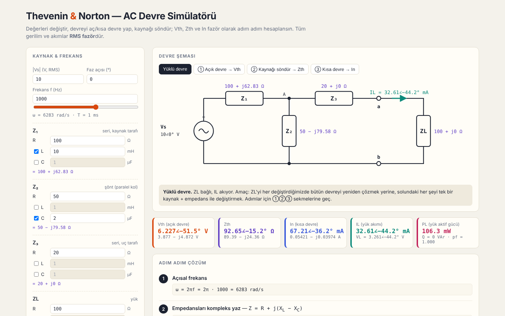

# Thevenin & Norton — AC Circuit Simulator

An interactive, single-file web tool that finds the **Thevenin and Norton equivalents of an AC circuit** step by step, with all values as RMS phasors.

**▶ Live demo:** <https://eneserdogans.github.io/demos/thevenin/>

## What it does

- Change the source (|Vs|, phase) and frequency; ω and T update instantly
- Build Z₁, Z₂, Z₃ and Z_L from R, L and C (each element can be turned on/off)
- Four circuit views on the schematic:
  1. **Loaded circuit** — I_L flows through Z_L
  2. **Open circuit → V_th**
  3. **Source killed → Z_th**
  4. **Short circuit → I_n**
- Result cards: V_th, Z_th, I_n, I_L and load power (P, Q, power factor) in both polar and rectangular form
- **Step-by-step solution** that shows every formula with the current numbers, so it can be used for studying

## Why

I made it while studying AC circuit analysis (EE202). Doing the same Thevenin/Norton steps by hand for many values is slow; with this tool I can change one value and see how every step changes.

## Run

No build step and no dependencies. Open `index.html` in any modern browser, or use the live demo link above.

## Tech

Plain HTML, CSS and JavaScript — complex-number math and SVG schematic written from scratch.

## License

MIT — see [LICENSE](LICENSE).
